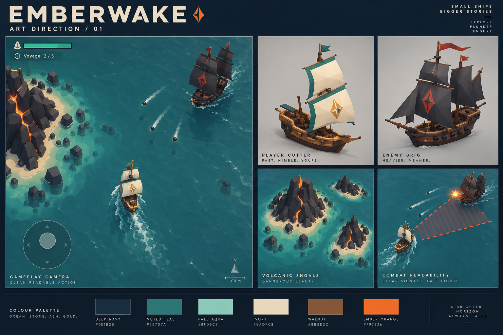
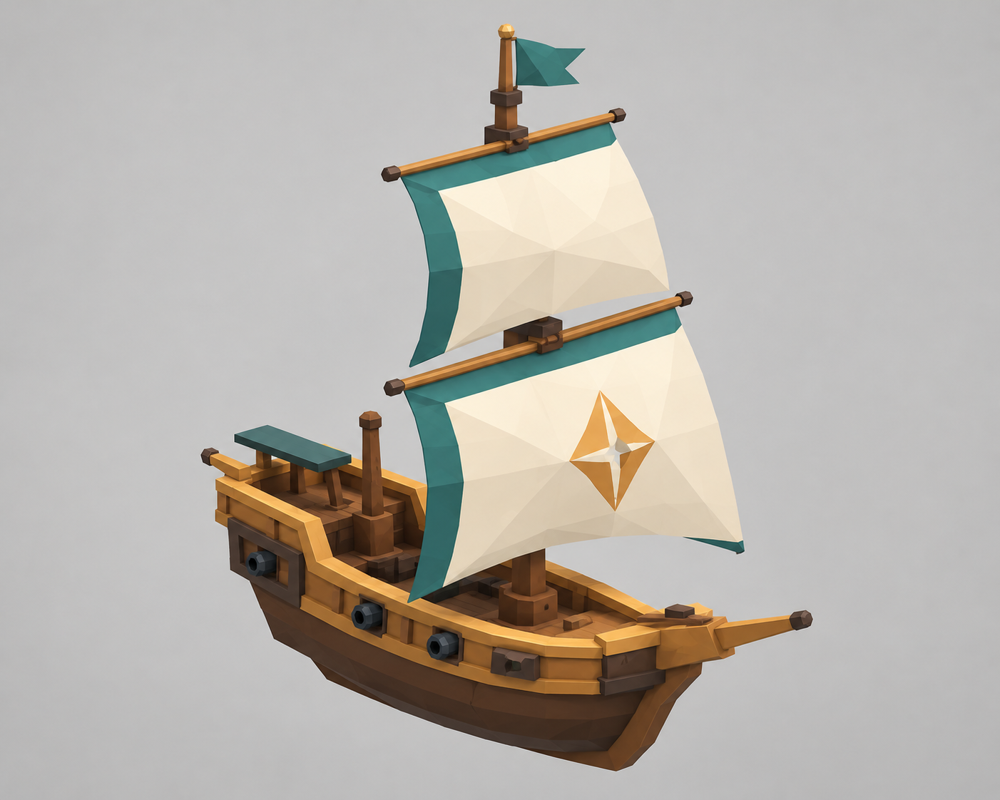
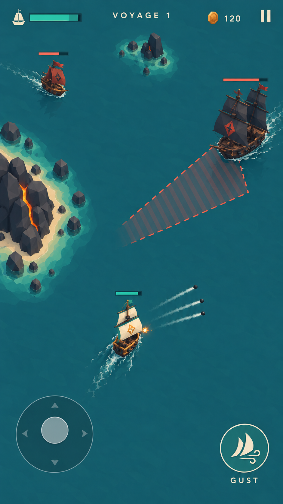

# Emberwake art source of truth

> V1 visual reference. Palette and material principles remain useful, but the active camera, team identity, class scale and HUD are defined in [V2 production baseline](Production/FLEET-DUEL-PRODUCTION-V2.md). The v1 joystick render is superseded.

Version 1 • 13 October 2026 • Production baseline proposal

## Governing images

The mood board governs shape language, palette relationships, material simplicity and atmosphere. The isolated cutter below governs the hero's visible design. The gameplay image governs the intended portrait composition, with the explicit corrections listed here. These are AI renders, not Unity captures. Numeric specifications and gameplay readability take precedence over incidental image detail.

## Visual character

Angular miniature wooden ships on a quiet teal ocean. Large sails carry identity; compact hulls carry weight. Volcanic rocks create dark framing shapes, with small ember cracks as accents. Keep the game bright enough to read on a phone outdoors. The reference's simple silhouettes and empty water matter more than surface detail.

Use broad faceted surfaces, matte materials, simplified bevels and few texture transitions. No realistic rope networks, dense planking, tiny crews, photoreal waves or fine surface noise. Ship damage is a brief flash, smoke and a few chunks; no gore.

## Canonical palette

These values are authoritative; generated swatch labels and rendered lighting can differ.

| Use | Hex | Rule |
| --- | --- | --- |
| Deep navy | #0E1B2B | HUD panels and deep shadow accents |
| Sea teal | #2D777A | Main water color; subdued enough for white projectiles |
| Shallow aqua | #8FD6C9 | Thin shore and navigation accents |
| Sail ivory | #EADFC8 | Hero sails and primary text |
| Walnut | #885E3C | Hull base with restrained lighter timber trim |
| Ember orange | #F97326 | Volcanic cracks and muzzle flash |
| Danger coral | #F26F5B | Enemy warnings with a striped shape cue |
| Player teal | #35BFA7 | Player health, confirmed interaction and ability readiness |

Limit highly saturated emissive accents to less than 5% of a typical combat frame. Never use orange lava coloration as the only danger indicator. All hostile firing areas have coral borders plus stripes; player projectiles are bright ivory with distinct short trails.

## Camera and composition

Portrait 9:16 baseline, support taller aspect ratios. Use an orthographic camera tilted 65 degrees downward from the horizontal, fixed world yaw, and a damped follow target. Player heading does not rotate the entire camera. Default player anchor is near 50% width and 62% height, with gentle direction look-ahead and arena-edge clamping. Recenter before hiding relevant threats.

At baseline scale the full hero silhouette should occupy roughly 12–16% of screen width; normal brig 18–22%; captain at most 26%. Choose camera size against the mesh's projected bounds rather than assuming world length maps directly to width. Keep at least 65% of a typical frame open water. Terrain can cover up to 25% during closer passages only if escape routes remain visible. Do not spawn enemies behind the bottom control area.

Art review uses 360 × 640 and 1080 × 1920 gameplay captures, plus one tall-phone capture. At the small size, the player, enemy types, projectile direction, safe space and Gust state must remain legible without zooming.

## Hero cutter specification

Asset ID SHP_Player_Cutter_01. Warm walnut hull, amber wood rim, one main mast, two vertically stacked ivory square sails with teal edge bands, one teal pennant, one flat amber diamond emblem on lower sail, short bowsprit. Three cannon muzzles per side; the isolated render shows three visible muzzles and supersedes the original generation prompt's two-muzzle request. The lower sail emblem should be a flat texture, not the raised geometry suggested in the render.

Hull length 6 units excluding bowsprit; beam approximately 2.4 units; waterline-to-mast height approximately 5.5 units. These are production proportions to tune against the camera. Broad uninterrupted sail shapes are more important than exact naval realism. No human rig. Keep hull, sails and pennant separable for subtle animation or replace sails with authored low-poly meshes if generation fuses them.

Two-sided sails must have either real slight thickness or a deliberate two-sided material. Do not accidentally duplicate all geometry. Three visible cannons per broadside match the gameplay volley. Cannon sockets, collision geometry and particle attachment points are authored in Unity and do not depend on generated mesh naming.

## Other assets

Raider: single rust sail, smaller and narrower than player, triangular pennant. Brig: two masts, charcoal sails, rust-red flags, wider stern. Captain: reuse brig with larger pennant, one amber prow ornament and a controlled scale increase. Rammer: reuse raider with an obvious blunt reinforced bow; no separate expensive hero model needed.

Islands use large irregular basalt facets, occasional orange fissures, a thin sandy perimeter and pale aqua water shallows. Produce three cluster silhouettes: narrow ridge, rounded cluster and two-spire cluster. Islands are scenery geometry; lava glow is a small material mask. Use separate authored shallow-water decals or geometry so a generated white base never becomes part of the rock model.

## Lighting and water

One soft directional light with a warm neutral key; cool ambient fill. Use cheap contact shadows or restrained real shadows depending on device performance. Avoid volumetric fog, depth of field, screen-space reflections and heavy bloom. Simulate bobbing visually on a child transform; gameplay remains on a plane.

Water should be mostly flat teal with slow low-amplitude broad color variation. A simple URP shader and sparse foam strips are sufficient. Wake opacity and lifetime must leave clean space quickly; do not accumulate a dense lace pattern behind every ship. Use a flat-color fallback shader on low quality.

## Combat effects

White cannon trail lifetime starts at 0.15–0.25 seconds. Small warm flash lasts around 0.08 seconds; smoke expands then disappears within 0.5 seconds. Damage flash lasts about 0.08 seconds. Sinking takes about one second with three to five chunky pooled debris pieces; a pickup marker remains. Avoid filling an entire enemy silhouette with continuous flames.

Telegraph remains visible for the attack wind-up, then fades at fire. Its geometry must match the actual firing pattern. Heavy cannon warning is a side-facing strip or trapezoid; ram warning is a narrow forward lane. The portrait render's diagonal warning is illustrative, not a literal hitbox or approved firing direction.

## UI baseline and render corrections

Use restrained navy panels, ivory typography, thin teal borders and broad, rounded touch targets. Use native UI text and vector/simple sprite icons, not text cut out of generated images. Combat control art must respect a minimum 48-dp touch area and device safe areas. Use a redistributable font with recorded license. Health bars have shape and icon context, not color alone.

Required corrections when translating AI art into Unity:

1. Flatten and simplify the water compared with both generated scene images.
2. Reduce the portrait image's large brig to the normal enemy size limits above; its current size is closer to a captain presentation.
3. Shorten cannon trails and wakes. Do not copy the render's long smoke lines as persistent effects.
4. Align projectiles and telegraphs to actual cannon sides. Rendered volleys do not define aim math.
5. Rebuild all UI with consistent spacing; shrink the illustrative joystick if it obscures too much water while preserving its touch area.
6. Keep the hero emblem flat and use three cannon sockets per side. Remove any extra generated cannon holes or unsupported rigging.
7. Ignore the mood board's incidental slogans, voyage fraction and scale legend; they are not required game copy.

## Review and change control

An imported asset passes art review when it matches the canonical sail colors, reads from the gameplay camera, fits projected size limits, has a clean silhouette at 360-pixel width, and introduces no realism or detail inconsistent with adjacent assets. Compare side-by-side with the mood board and isolated cutter. Performance and gameplay visibility are hard requirements even if a more complex mesh looks attractive close up.

Save successor art as v2, v3 and so on. Update this file's asset rules and the README's baseline links together. Do not silently mix alternate palettes or ship designs. Record why each changed rule helps the actual game.
