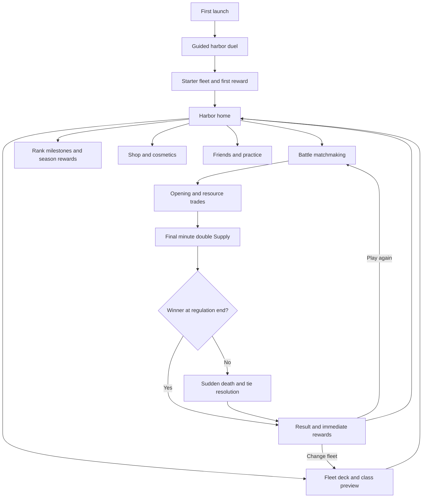

# Emberwake naval duel concept

Version 2 • 13 October 2026 • Active gameplay baseline

## Product definition

**Build a fleet deck. Call ships into battle. Break the enemy harbor.** Emberwake is a portrait 1v1 real-time naval strategy game for Unity. Players spend regenerating Supply to deploy miniature ship classes and tactical orders. Ships navigate and fight automatically. Position, timing, resource trades and card cycling decide the match.

The user confirmed Clash Royale as the reference and clarified that three minutes is a suggestion. Adopt its three-minute regulation and up-to-two-minute overtime structure as the initial pacing model. Aim for satisfying, understandable matches that players voluntarily replay. We will test duration rather than promise that a specific timer creates retention.

This supersedes the v1 PvE voyage, joystick, Gust button, player-controlled cannon arcs, survival upgrades, bosses and ad revives. The original clip remains an art reference. The [Clash Royale study](CLASH-ROYALE-STUDY.md) provides the research basis; values in this document are our proposed tuning, not asserted Supercell values.

## The complete player journey

Players do not need to visit the Shop or open every reward animation to queue again. Earned rewards commit automatically; the presentation can be skipped. Matchmaking cannot begin while a deck edit is uncommitted. Fleet changes are locked once a match is assigned.

## Screen flow and important states

| Screen | Main content and action | Return or failure behavior |
| --- | --- | --- |
| Boot | Load configuration, authenticate guest/account, check service version | Offline practice available; actionable connection retry |
| Tutorial | Deploy a Cutter, counter Skiffs, save for Ironclad, destroy an outpost | Repeat explanations on demand; no real opponent |
| Harbor | Rank, selected deck, daily reward progress, large Battle button | Avoid promotional modal on every visit |
| Fleet | Eight slots, collection grid, cost average, role summary | Illegal/incomplete deck cannot enter queue |
| Card detail | Cost, target type, strengths, weakness, level and short demonstration | Preview before spending upgrade currency |
| Matchmaking | Selected mode, elapsed queue time, Cancel | Revalidate cancellation versus server match assignment |
| Match intro | Opponent name, arena, synchronized countdown | Show reconnect state if client falls behind |
| Battle | Entire arena, four cards, next card, Supply, timer and objectives | Live PvP cannot pause; settings overlay does not stop server |
| Results | Win/loss/draw, objectives, rating change, committed rewards | Play Again and Edit Fleet equally clear |
| Reward reveal | What was earned, blueprint progress, first unlock | Skippable; no lost rewards if app closes |
| Rank journey | Current division and next fixed milestone | Preview future fleet unlocks |
| Season track | Free and premium progress, remaining season time | No claim required before starting another battle |
| Shop | Clearly priced cosmetics and optional defined bundles | Cancelled/failed purchase leaves player state intact |
| Social | Friends, direct challenge and later guilds | Practice never changes competitive rank |
| Settings/log | Audio, haptics, accessibility, account, match history | Replays and rejoin available where supported |

Proposed onboarding: a short scripted deployment lesson, then one full bot duel, then Harbor with eight starter cards. First meaningful deployment should happen within 20 seconds of entering the tutorial. Show the resource rule through play before introducing the collection economy. Do not invent a human opponent for the bot lesson.

## Arena and camera

One symmetrical arena with two navigable channels. Each side has two forward cannon outposts and one central harbor headquarters. A basalt reef separates the halves, with open water passages left and right. There are no land bridges, random storms or neutral monsters in the first version.

Initial simulation bounds: X from −12 to +12, Z from −18 to +18. Headquarters at (0, −15) and (0, +15); outposts at (−7, −10), (+7, −10), (−7, +10), (+7, +10). Reef spans the midline near Z=0, with four-unit-wide gaps centered at X=−7 and X=+7. These coordinates are a graybox starting point. Ship collision width must allow two opposing vessels to pass or engage without permanently blocking a channel.

Fixed orthographic camera, high oblique angle, entire arena visible. Mirror the presentation so each player sees their own harbor at the bottom; convert input back to canonical server coordinates. Do not rotate the underlying simulation. Main HUD occupies the bottom approximately 20% of the screen. Team identity uses pennant color, health bars and objective emblems; class identity uses silhouette. The same ship class is playable on either team.

## Deployment and card cycling

Each deck contains eight distinct cards. Four appear in hand; the remaining four form an ordered queue with a next-card preview. On a successful play, remove the selected card, draw the front of the queue into its slot and append the played card to the back. It becomes available again after four additional card plays. Failed or cancelled deployment never advances the queue.

Drag a card onto a legal location, or tap a card and then tap the battlefield. Preview footprint, team color and invalid terrain before release. Cancel by returning to the command tray. The server checks card ownership, current hand, Supply, placement and match phase. Charge Supply and cycle the card atomically on acceptance, then use a short, readable deployment delay of 0.6 seconds. Client animation is predictive presentation only.

Ships initially deploy in friendly-half navigable water, outside permanent structure footprints and the reef. Destroying an enemy forward outpost unlocks a shallow deployment pocket in that lane on the opponent's half; the exact pocket is an authored polygon, not the whole enemy side. Orders can target any visible water in the arena unless their definition says otherwise. Permanent bases cannot be moved or redeployed.

Starting Supply: 5. Maximum: 10. Baseline generation: one Supply per 2.8 seconds, then the phase multiplier. These are prototype values. Supply resets every match, cannot be purchased during battle, and does not carry between matches. The cap rewards timely action, but the tutorial must also teach saving for a supported push.

## Timing and victory rules

| Elapsed battle time | Phase | Supply multiplier | Purpose |
| --- | --- | --- | --- |
| 0–120 seconds | Regulation opening and trades | 1× | Learn opponent deck, defend and build pushes |
| 120–180 seconds | Regulation finish | 2× | More pressure and counterplay |
| 180–240 seconds if tied | Sudden death | 2× | First decisive objective advantage ends match |
| 240–300 seconds if still tied | Final sudden death | 3× | Fast final exchange |
| At 300 seconds | Tie resolution | Stop simulation | Compare remaining defenses |

Destroying the headquarters wins immediately and counts as a complete three-objective victory. Otherwise, at 180 seconds, the player with more destroyed enemy outposts wins. If tied, enter sudden death: the first server tick leaving one player with more destroyed objectives wins. Resolve all damage within that tick together, so simultaneous equal outpost destructions continue the tie. Simultaneous destruction of both headquarters is a draw.

At 300 seconds, if still tied, compare each side's lowest remaining permanent-structure HP. The side whose weakest remaining structure has more HP wins; exact equality is a draw. This is our explicit implementation rule. No additional damage countdown extends the advertised five-minute battle limit. Apply the final tick's valid damage before checking the timer result. Ignore projectiles still in flight after the match is resolved. A headquarter win always takes priority over an outpost result.

Use a single server clock. Match countdown and result presentation sit outside the battle timer. A match can end earlier than three minutes. Disconnection does not pause battle: units continue existing orders and Supply continues to accumulate to its cap. A reconnect restores authoritative state; prolonged absence has no free defensive bot takeover in competitive play.

## Starter deck and callable ship classes

All values are initial equal-level tuning. DPS alone is not a balance target; placement, travel time, range and target restrictions matter. Six ship classes plus two orders create an eight-card starter deck with average cost 3.25.

| Card | Cost | Role and behavior | Counter and weakness |
| --- | --- | --- | --- |
| Skiff Pack | 2 | Three tiny fast boats; overwhelm isolated single-target units | Grapeshot and Mortar splash |
| Cutter | 3 | Generalist escort, medium range, three-shot volley | Outranged by Mortar; distracted by cheap Skiffs |
| Ironclad | 5 | Slow armored vessel targeting structures, absorbs fire for escorts | Swarm damage and unsupported pushes |
| Mortar Boat | 4 | Slow long-range splash against units and structures, minimum firing range | Fast units reaching its blind area |
| Ram Boat | 4 | Fast structure-targeting pressure; stronger first collision after a run-up | Cheap interception and concentrated defense |
| Repair Launch | 3 | Follows injured allies, heals one friendly combat ship at a time | No attack; cannot sustain alone; focus fire |
| Grapeshot | 2 | Immediate small-area anti-swarm damage after a visible 0.35-second warning | Poor against high-HP ships; reduced structure damage |
| Smoke Screen | 3 | Four-second zone reduces enemy fire rate by 25% | Ships can move out; no movement damage and no stacking |

Smoke has a translucent boundary and firing-rate status icon; it does not make units invisible or hide gameplay state. Repair Launch cannot heal itself, other Repair Launches or permanent structures. This prevents indefinite support chains and base repair stalls. Ship orders are autonomous; players cannot select an individual ship and steer it.

| Ship | HP | Attack or heal | Range | Speed units/s |
| --- | --- | --- | --- | --- |
| Each Skiff | 95 | 18 damage every 0.9 s | 2.5 | 2.4 |
| Cutter | 520 | 3 × 24 damage every 1.8 s | 4.0 | 1.6 |
| Ironclad | 1,300 | 60 damage every 1.8 s, structures only | 2.5 | 0.9 |
| Mortar | 360 | 100 splash damage every 2.4 s, radius 1.1 | 2.5 minimum / 6.5 maximum | 1.1 |
| Ram | 540 | 300 first charged impact, then 80 every 1.4 s, structures only | Contact | 2.5 |
| Repair Launch | 320 | Heal 35 every 1.2 s, single eligible ally | 3.0 | 1.3 |

Ram charge requires three units of uninterrupted forward travel; the charge resets after target contact. All units can be damaged by all attacks in the initial version. No air, underwater or stealth targeting layer. Grapeshot deals 100 unit damage within radius 2.3 and 30 damage to structures. Outposts start at 1,800 HP with a 45-damage shot each second and six-unit range. Headquarters starts at 2,800 HP with a 60-damage shot each second; its weapon activates when damaged or when a friendly outpost is destroyed. These values will change through testing.

Each class uses a clear target priority with nearest-distance and entity-ID tie breaks. Building-targeting ships ignore enemy ship aggro but still respect collision avoidance. Generalists prefer valid nearby combat targets; otherwise they advance toward a permanent objective. Repair chooses the eligible nearby ally with the largest missing-HP percentage. Reevaluate at bounded intervals and retain a target briefly to avoid jitter.

## Fleet expansion

An eight-card roster alone does not create meaningful deckbuilding. The slice proves the eight-card battle loop, while the first deckbuilding test needs twelve cards. Add four alternatives using small asset variations: Interceptor (cost 3, anti-ship pursuit), Bomb Ketch (4, short-range splash), Anchor Battery (3, temporary defensive buoy), and Tailwind order (2, localized allied movement boost). These are proposed expansion roles requiring separate tuning; they are not falsely represented as finished assets.

Test three starter archetypes once alternatives exist: inexpensive pressure, protected siege and defensive counterattack. Avoid presenting every fleet as a mandatory tank/healer recipe. A good deck should have an objective threat, a swarm answer and an affordable response, with meaningful trade-offs.

## Battle decisions and feedback

Show the opponent spending through deployed units; do not expose exact hidden hand or Supply. Read the enemy's commitment, defend for less, then support surviving defenders. Deploying a slow Ironclad near your harbor buys time to regenerate Supply before it reaches the channel. Committing too much in one lane invites pressure in the other. A cheap card advances your cycle but still has an opportunity cost.

Every attack needs readable ownership, travel and impact. Swarms share a compact formation and separate health states; the card is one deployment. Cannon flashes stay short. No screen-filling effects. The new camera must show both channels simultaneously, because off-screen action would undermine this decision structure.

## Persistent progression

Keep separate counters for rank, gold, blueprints and season progress. All starter cards are immediately usable. Rank milestones unlock alternate classes predictably. Gold plus class blueprints upgrade cards in the progression mode; equal-level practice and a later competitive normalized mode use fixed stats. Prototype battles use equal levels throughout to isolate balance from spending or collection age.

Start economy experiments with five upgrade steps and modest, explicit stat changes; do not import v1's permanent player hull/cannon/handling upgrades. Never change a card's Supply cost as it levels. A player's battle stats are snapshotted at match start and remain fixed for that match. Do not sell exclusive essential counters.

The result screen grants rank change, gold, blueprint progress and season progress in a single server transaction keyed by match ID. Daily goals can offer a visible bonus for the first few wins, with ordinary progression still available afterward. Initial prototype uses deterministic rewards. The reward schedule, daily reset and overflow handling live in configuration; the client never invents rewards.

## Revenue and repeat play

Primary proposed revenue: sail sets, hull finishes, harbor cosmetics, emotes and a seasonal pass once enough seasonal content exists. Progression bundles can be evaluated later alongside fairness and level-spread data; the study describes Clash Royale's model but does not establish that identical pricing would work for Emberwake.

No rewarded revive, extra Supply purchase, ad interruption or paid card draw during PvP. The v1 revive plan is cancelled. Consider a clearly optional post-match cosmetic reward ad only if it does not delay Play Again or undermine the intended premium presentation. The initial duel test needs no ads or store.

The result should explain what happened: lane pressure, objective damage and the opponent's deck are useful. Avoid fabricated near-wins and artificial scarcity. A one-tap rematch, understandable loss and a worthwhile deck adjustment are better hypotheses for sustained replay than increasing frustration.

## Validation and scope

Measure tutorial deployment success, time to first full match, voluntary Play Again rate, match duration distribution, overtime frequency, three-objective finishes, draws, deck diversity, class usage/win rate, disconnects, queue time and D1/D7 retention. Segment by skill, deck and card levels. Ask testers whether losses felt understandable and whether they wanted another match.

First compare standard 180-second regulation against a 150-second variant with the same escalation proportions; do not change rewards, deck balance and timer at once. Report sample size and confidence, not just a winning percentage. Keep the 180+120 structure until evidence supports a change.

Delivery sequence: bot duel with eight cards and all match states; private online duel with reconnect and authoritative outcomes; twelve-card deckbuilding test; progression and rewards; controlled soft launch; cosmetics and season track. Friends, guild donations, ranked seasons, replays, events and advanced ship abilities expand after the core loop works. PvP changes scope substantially, so the v1 8–14-week estimate no longer applies.

Planning range for an experienced Unity developer with part-time art/backend assistance: approximately 2–3 weeks for a convincing offline duel, another 3–6 for a private online alpha, and another 6–10 for a small instrumented soft-launch candidate. These are rough planning ranges with substantial backend, matchmaking, device and content risk. No current build has been implemented or tested.

## Active visual and technical references

- [Naval duel battle render](Art/fleet-duel-battle-v2.png)
- [Fleet class mood board](Art/fleet-classes-v2.png)
- [V2 art and Unity production changes](Production/FLEET-DUEL-PRODUCTION-V2.md)
- [Original cutter isolated model reference](Art/player-cutter-v1.png), now a deployable class rather than a controlled protagonist

Written rules override incidental generated geometry, card counters and render annotations. The images are art targets, not evidence of a working Unity game.
